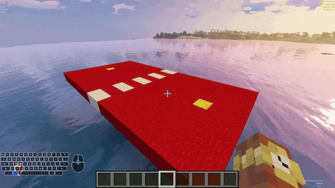

# Creating & Managing Arenas

Arenas are the stages duels are fought in. A match needs a free arena with **two spawn points** set and the arena **enabled** — otherwise requests fail with "no arena available".

<!-- GIF PLACEHOLDER
File: assets/gifs/create-arena.gif
What to record:
Full flow: /duels create, /duels set pos 1 and 2, /duels info, /duels toggle, then a test duel starting in the arena.

Recommended length: 10-20 seconds
-->


## Creating an arena

```text
/duels create <name>
/duels set <name> 1
/duels set <name> 2
/duels toggle <name>
```

1. `/duels create Colosseum` — creates a disabled arena.
2. Stand where fighter 1 should spawn → `/duels set Colosseum 1`.
3. Stand where fighter 2 should spawn → `/duels set Colosseum 2`.
4. `/duels toggle Colosseum` — enables it so matches can use it.

!!! tip "Spawn placement"
    Face the spawns toward each other and keep ~15–30 blocks distance. The pre-match countdown freezes movement, so players get a fair look at the arena before `GO!`.

## Managing arenas

| Command | What it does |
|---|---|
| `/duels list` | Lists all arenas (color-coded: red = disabled, blue = no positions, green = available, dark red = in use) plus kits, queues, signs and lobby status |
| `/duels info <arena>` | Shows state, positions, bound kits and settings |
| `/duels toggle <arena>` | Enable/disable (flips current state) |
| `/duels enable <arena>` / `/duels disable <arena>` | Explicit on/off |
| `/duels teleport <arena> [1\|2]` | Teleport yourself to a spawn point (aliases: `tp`, `goto`) |
| `/duels delete <arena>` | Deletes an arena (must not be in use — disable it first) |
| `/duels setgroup <arena> <group>` | Group arenas for the selector GUI |
| `/duels setarenaitem <arena>` | Sets the GUI display item to the item in your hand |

All need `duels.admin`.

## Kit binding & display

- `/duels bind <kit>` — opens the arena-bind GUI: choose on which arenas a kit may be used. Bound kits ignore random arenas they don't fit.
- `/duels setarenaitem <arena>` — hold an item, run the command: that item represents the arena in selector GUIs.

## Spawn points

Stored per arena (`arenas.json`, managed in-game — don't hand-edit). Both positions must be set or the arena counts as unavailable. Re-running `/duels set <arena> 1|2` moves a spawn.

## Spectator-relevant notes

Spectators are leashed around the arena center (`spectate.wall-limit.radius`, default 25 blocks) — build spectator-freedom-friendly arenas or raise the radius for huge maps. See [Spectating](../spectating.md).

## Next

- Destructible arenas? [Regeneration](regeneration.md).
- Matchmaking signs for arenas? [Queue & Signs](../queue.md).
