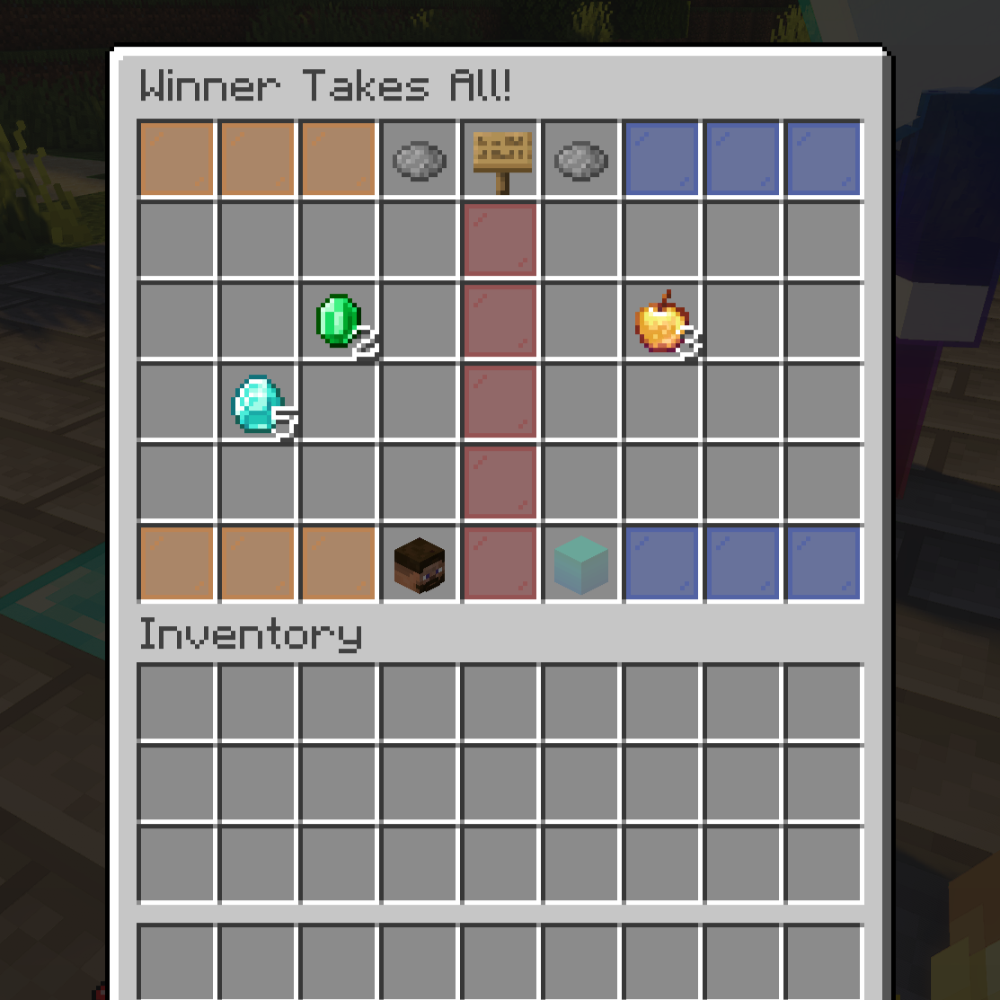

# Betting

Two independent systems: **money bets** (Vault) and **item bets** (secure GUI). Both are optional per duel and can be disabled globally. Party duels never support betting.

<!-- IMAGE PLACEHOLDER
File: assets/images/item-betting.png
What to capture:
Item betting GUI open with items placed on both sides and READY states visible.

Recommended size: 1200x700
-->


## Money betting

```text
/duel Steve 100
```

- Requires Vault + an economy plugin, and `request.money-betting.enabled: true`.
- The amount is taken from **both** players at match start; the winner receives double.
- With `use-permission: true`, players need `duels.use.money-betting`.
- Without Vault/economy, money bets are rejected with "Money betting is currently disabled."
- Queues can also carry a money bet (set at queue creation).

## Item betting

1. Enable **Item Betting** in the request GUI (or `/duel <player> <bet> true ...`).
2. After accept, both players put items into the shared GUI and press READY.
3. The match starts only when **both** are ready. Closing early refunds instantly.
4. The winner receives all bet items after the match.

Anti-dupe design: items enter a bet only on mutual confirm, GUI close = instant refund, and bets re-validate at match start.

### World restriction

```yaml
request:
  item-betting:
    allowed-worlds: []   # empty = everywhere; e.g. "Duels, world"
```

Use this to stop value moving between worlds via bets (e.g. creative/give worlds vs. survival). Bypasses: OPs. Denied attempts show "Item betting is not allowed in this world."

## Disabling betting

- `request.item-betting.enabled: false` → toggle disappears from the GUI.
- `request.money-betting.enabled: false` → money amounts are rejected.
- Granular permissions (`duels.use.item-betting`, `duels.use.money-betting`, `duels.use.*`) when the matching `use-permission` is on.
