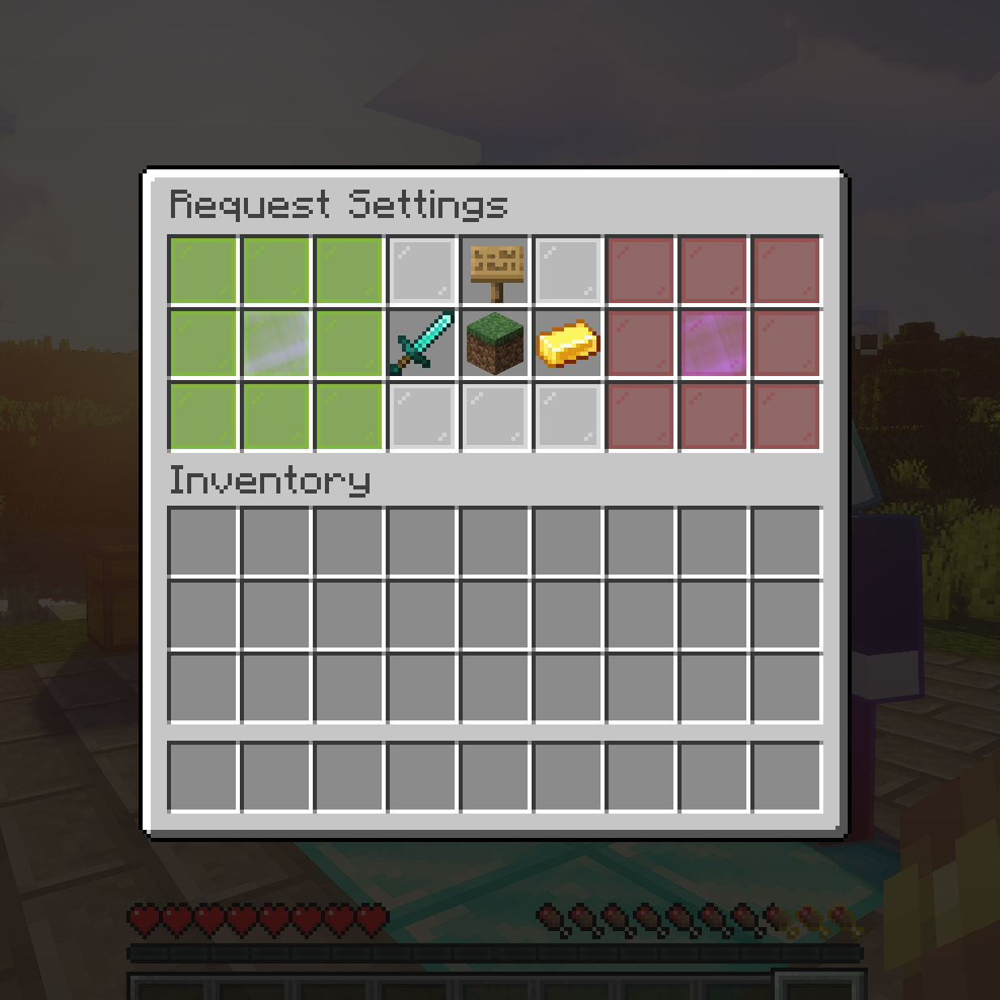

# Starting a Duel

## Challenge someone

```text
/duel <player>
/duel <player> <money-bet> [true] [kit|-]
```

- `/duel Steve` — opens the request settings GUI for a plain duel.
- `/duel Steve 100` — same, with a $100 money bet (needs Vault + enabled money betting).
- `/duel Steve 100 true` — additionally opens item betting after accept.
- `/duel Steve 100 true Diamond` — skips the GUI and sends the request immediately with kit `Diamond`.
- Use `-` instead of a kit name for own-inventory mode: `/duel Steve 0 false -`.
- Add `--force` (needs `duels.force`) to start immediately without accept, e.g. for events: `/duel Steve Diamond --force`. Forced duels cannot use item betting.

<!-- IMAGE PLACEHOLDER
File: assets/images/request-settings.png
What to capture:
Duel request settings GUI with kit/arena/own-inventory/item-betting options, SEND and CANCEL sides visible.

Recommended size: 1200x700
-->


### The request settings GUI

Opens automatically unless all settings were given via command. From left to right:

| Button | What it does | Permission / config |
|---|---|---|
| Kit selector | Pick the kit (`Random` if none) | `request.kit-selecting.*`, `duels.use.kit-select` |
| Own inventory | Fight with your gear instead of a kit | `request.use-own-inventory.*`, `duels.use.own-inventory` |
| Arena selector | Pick the arena (`Random` if none) | `request.arena-selecting.*`, `duels.use.arena-select` |
| Item betting | Toggle the item-bet GUI step | `request.item-betting.*`, `duels.use.item-betting` |
| Request details | Summary of the current setup | — |
| SEND (green) / CANCEL (red) | Send or discard the request | — |

Option button slots, rows and materials are configurable under `guis.settings.*`.

## Requirements to duel

Both players must: be online and visible, not be in a match/queue/spectating, have no duel cooldown active, accept requests (`/duel toggle`), and be in allowed worlds/regions (see `duel.enabled-worlds`, `blacklisted-worlds`, WorldGuard `duelzone`). Depending on config: cleared inventory, no creative mode, not combat-tagged, potion/kit rules.

Use `/duel toggle` to stop receiving requests at all.

## After the fight

- Winner is teleported after `teleport-delay` seconds — to the **lobby**, or back to their **pre-duel spot** with `teleport-to-last-location: true`.
- Both sides get a clickable **[REMATCH]** offer (same settings, expires per `duel.match.rematch.expire-after`, 1v1 only).
- `/duel forfeit` leaves a running match as a loss (disable with `duel.forfeit.enabled`).
- `/duel like <player>` / `/duel dislike <player>` rates a recent opponent (30-minute window by default).
