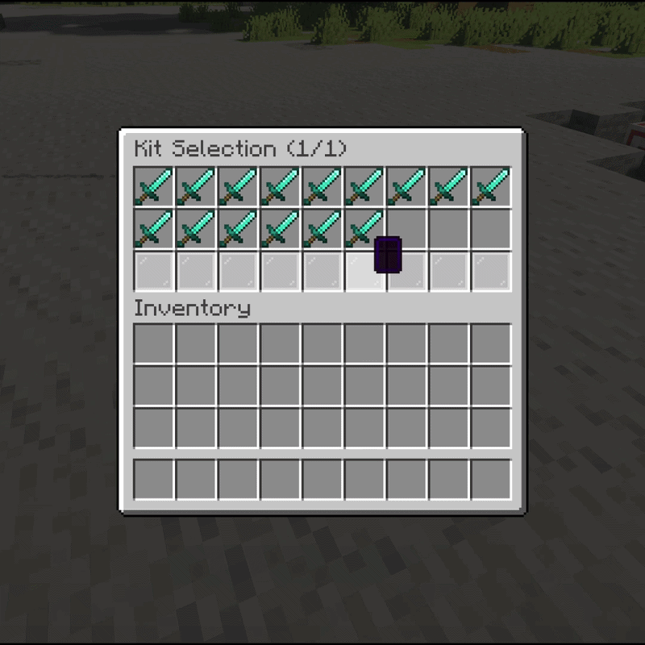

# GUIs

All GUIs are click-driven; filler materials, rows and most button items are configurable (see [Config Reference](configuration/config-reference.md), `guis.*`). Message texts live in `langs/...` under `GUI.*`.

<!-- VIDEO IN USE (was an image placeholder)
File: assets/gifs/guis-overview.mp4
What to capture:
Collage or sequential screenshots: request settings GUI, kit selector, arena selector, queue browser.

Recommended size: 1200x700
-->

## Request settings (`/duel <player>`)

Pick kit, own-inventory mode, arena and item betting, then SEND (green, left) or CANCEL (red, right). Only enabled options appear. Layout: `guis.settings.rows`, `option-button-slots`, `send-button.*`, `cancel-button.*`, per-button materials.

## Kit / arena / queue selectors

Paged browsers (`/kit`... no — opened from request GUI, `/queue`, or `/duels bind`):

| GUI | Opens from | Config |
|---|---|---|
| Kit selector | Request GUI kit button | `guis.kit-selector.rows` (1–5) |
| Arena selector | Request GUI arena button | `guis.arena-selector.rows` (1–5) |
| Queue browser | `/queue` | `guis.queues.rows` (1–5), `inherit-kit-item-type` |
| Spectate browser | `/duel spectate` | Fixed 4-row layout, live heads |

## Item betting GUI

Two-sided: each player fills their 4-wide section and presses READY (their own side only). A 5-step countdown runs once both are ready, then the match starts and items become the bet. Closing early refunds instantly. No config layout (fixed 54-slot design).

## Bind GUI (`/duels bind <kit>`)

Choose which arenas the kit may run on. Persists per kit.

## Options GUI (`/duels options <kit>`)

Toggle kit characteristics: Soup, UHC, Combo, Sumo, Hunger, Loka, Best-of-3. See [Kits](kits/index.md).

## Kit editor (`/kit edit <kit>`)

Edit kit contents visually; `/kit save` writes, exiting without saving discards. Aborted automatically if you enter a queue/match mid-edit.

## Post-match inventories

After a match (if `display-inventories`), clickable names in chat open the fighter's end-of-match inventory (`/duel _ <uuid>` behind the scenes). View-only, with effects/health/hunger/potion summary buttons.
