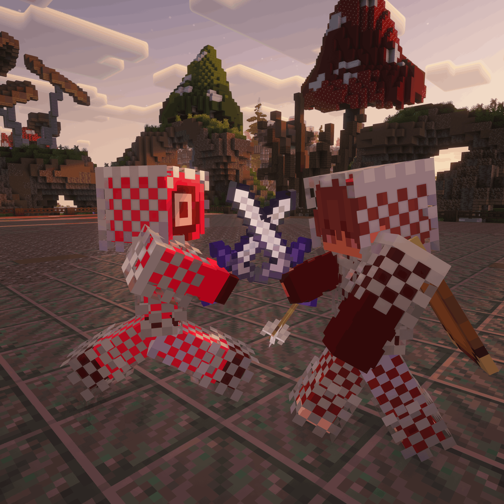

# Advanced Duels

<svg viewBox="0 0 24 24" fill="none" stroke="#ffffff" stroke-width="1.9" stroke-linecap="round" stroke-linejoin="round"><path d="M12 2.5 20 5.5v6c0 5-3.4 8.6-8 10-4.6-1.4-8-5-8-10v-6l8-3z"/><path d="M8.8 12.2l2.3 2.3 4.2-4.6"/></svg>

# Advanced Duels

Complete 1v1 and party duel system for Minecraft servers — arenas, kits, betting, queues, ELO ratings, spectating and safe updates.

v5.0 Paper &amp; Spigot 1.21 Java 21 Folia supported

[Get Started](getting-started/installation.md){ .md-button .md-button--primary }
[Commands](commands/player.md){ .md-button }

<!-- IMAGE PLACEHOLDER
File: assets/images/showcase.png
What to capture:
Eye-catching screenshot of two players fighting in a duel arena, ideally with the countdown title visible.

Recommended size: 1200x700
-->

## Everything duels need

- ⚔️

    **Duels**

    Challenge players in 1v1 or party matches, with requests, countdowns and fair spawns.

    [Learn more →](duels/index.md)

- 🗺️

    **Arenas**

    Dedicated arenas with spawn points, kit binding and automatic block regeneration.

    [Learn more →](arenas/index.md)

- 🥇

    **ELO & Stats**

    Per-kit ratings, leaderboards, killstreaks, wins, losses and player likes.

    [Learn more →](duels/rating-stats.md)

- 👁️

    **Spectating**

    Watch live matches from a browser GUI, with arena leash and stealth options.

    [Learn more →](spectating.md)

- 🎒

    **Kits**

    Custom kits with Soup, UHC, Combo, Sumo and Best-of-3 modes — or own inventory.

    [Learn more →](kits/index.md)

- 🔄

    **Safe Updates**

    Configuration migration with backups — updates never wipe your settings.

    [Learn more →](data.md)

## Requirements

- A **Spigot / Paper** server (1.21.x recommended; Folia is supported)
- Java 21

Optional but recommended: [Vault](https://www.spigotmc.org/resources/vault.34315/) + an economy plugin (for money betting), [PlaceholderAPI](https://www.spigotmc.org/resources/placeholderapi.6245/) (for placeholders and scoreboards).

## Quick installation

1. Drop `AdvancedDuels.jar` into your server's `plugins/` folder.
2. Restart the server.
3. Set the duel lobby with `/duels setlobby`.
4. Create an arena: `/duels create <name>`, set both spawn points with `/duels set <name> 1` and `/duels set <name> 2`, enable it with `/duels toggle <name>`.
5. Create a kit with `/duels savekit <name>` (or let players fight with their own inventory).

Read the full walkthrough in [First Setup](getting-started/first-setup.md).

## Where to go next

- New here? Start with [Installation](getting-started/installation.md), then [First Setup](getting-started/first-setup.md).
- Setting up fights? [Creating arenas](arenas/index.md), [Kits](kits/index.md), [Starting a duel](duels/index.md).
- Running the server? [Commands](commands/player.md), [Permissions](permissions.md), [Configuration](configuration/index.md).
- Something broken? [FAQ](faq.md) and [Troubleshooting](troubleshooting.md).
- Building on top? [Developer API](api.md).
