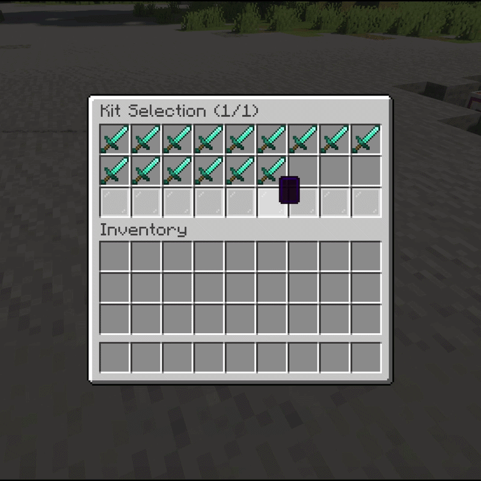

# Kits

Kits are predefined inventories (armor, weapons, potions, food) that fighters are equipped with. Alternatively, duels can be fought with each player's **own inventory** — no kit needed.

## Creating a kit

Put exactly what fighters should receive into your own inventory, then:

```text
/duels savekit <name>
```

| Command | What it does | Permission |
|---|---|---|
| `/duels savekit <name>` | Save your current inventory as a kit | `duels.admin` |
| `/duels loadkit <name>` | Load a kit into your inventory (preview/test) | `duels.admin` |
| `/duels deletekit <name>` | Delete a kit | `duels.admin` |
| `/duels setitem <kit>` | Set the kit's GUI icon to your held item | `duels.admin` |
| `/kit edit <kit>` | Open the visual kit editor | `duels.kiteditor` |
| `/kit save` | Save + exit the kit editor | `duels.kiteditor` |

<!-- IMAGE PLACEHOLDER
File: assets/images/kit-selector.png
What to capture:
Kit selector GUI open, showing several kits with icons.

Recommended size: 1200x700
-->


## Kit characteristics (special modes)

`/duels options <kit>` (alias `useoption`) opens the kit options GUI, toggling characteristics:

| Mode | Effect |
|---|---|
| `SOUP` | Right-click mushroom soup to heal (`soup.hearts-to-regen`, default 3.5 hearts) |
| `UHC` | No natural health regeneration |
| `COMBO` | No delay between hits |
| `SUMO` | Damage only from water/lava interaction |
| `HUNGER` | Hunger never depletes (players will not go hungry) |
| `LOKA` | Damage increased by 33% |
| `ROUNDS3` | Best-of-3 rounds — first to 2 round wins takes the match |

## Kit permissions & arena binding

- Enable `request.kit-selecting.use-permission`, then grant `duels.kits.<kitname>` (or `duels.kits.*` for all) to gate individual kits. A kit can also require permission by itself (`use-permission` on the kit).
- `/duels bind <kit>` opens the arena-bind GUI to restrict which arenas a kit may run on.

## Own inventory mode

If `request.use-own-inventory.enabled` is `true`, players can toggle **Own Inventory** in the duel settings instead of picking a kit. Related options:

- `drop-inventory-items: true` — items drop on death and are **NOT restored**. Only enable for hardcore-style servers, and raise `duel.teleport-delay` so winners can loot.
- `use-permission: true` — require `duels.use.own-inventory`.
- Per-player custom kits: players with the kit editor can save personal variants that load automatically when that kit is picked.

## Kit selector GUI

Rows and filler material: `guis.kit-selector.rows` (1–5, default 2). Button item per kit = its display item (`/duels setitem`).
