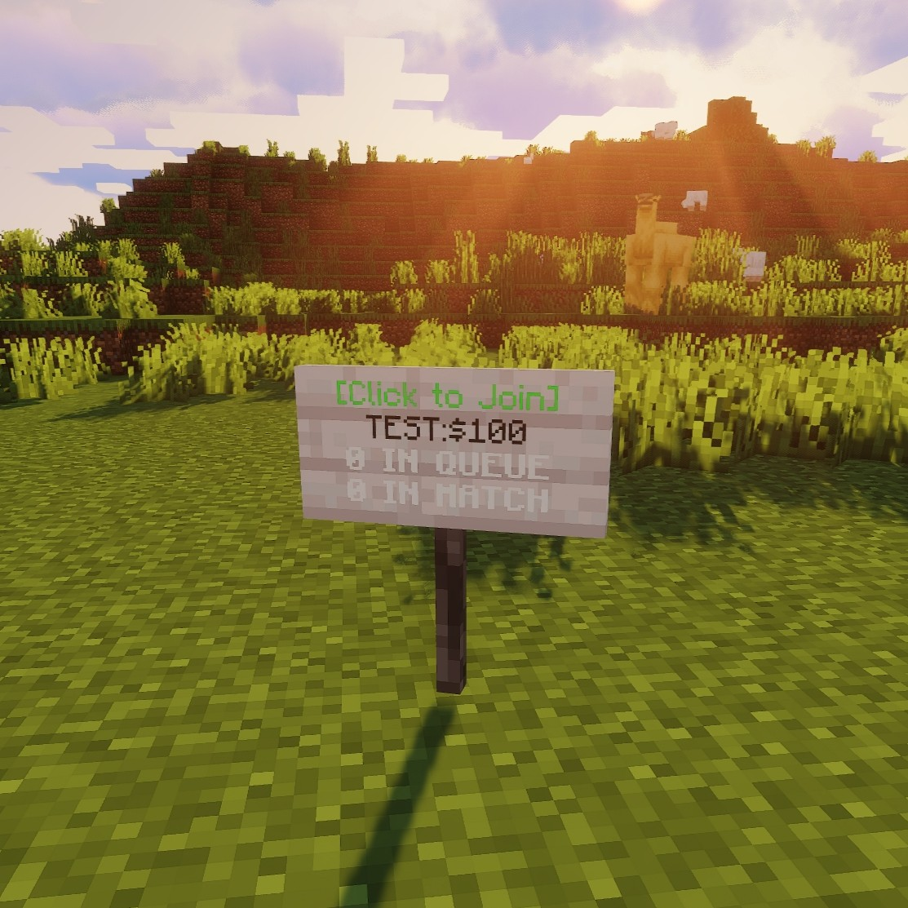

# Queue & Signs

Queues are automated matchmaking: join, get paired with a similarly-rated opponent, fight. Two systems exist side by side.

## Named queues (admin-created)

```text
/duels createqueue <name> <bet> <team-size> [<kit>|-]
/duels deletequeue <bet> [<kit>|-]      # aliases: delqueue, delq
```

- `<kit>` = kit name, `-` = own inventory.
- Players join via the queue GUI (`/queue`), `/queue join <name>` (alias `j`), or a sign. Leave with `/queue leave` (alias `l`).
- Blocked commands while queued: `queue.blacklisted-commands`.
- Money bet is taken on join; joining without funds is rejected.

### Queue signs

Stand looking at a wall sign and run:

```text
/duels addsign <queueName> <bet> <team-size> [<kit>|-]
/duels delsign      # while looking at the sign (alias: delsign handled via delsign)
```

Signs show queue name, bet, players waiting/in-match, and update live. Delete with `/duels delsign` while looking at it. Breaking a queue sign by hand is blocked — remove it with the command.

<!-- IMAGE PLACEHOLDER
File: assets/images/queue-signs.png
What to capture:
Queue signs on a wall showing queue name, bet and player counts, plus the queue GUI open.

Recommended size: 1200x700
-->


## Simple queue (quick matchmaking)

```text
/duel queue
```

Toggles a no-setup 1v1 queue using own inventory. First two waiting players are matched instantly. Messages: `QUEUE.simple-add`, `simple-remove`, `simple-found`.

## Matchmaking rules

- Opponents pair within `rating.max-difference` (default 400 ELO).
- Queue matches can exclusively change ratings (`rating.queue-matches-only`).
- Start/end/win/lose commands can be scoped to queue matches (`queue-matches-only` per group).
- Queues need a free compatible arena like any duel.
