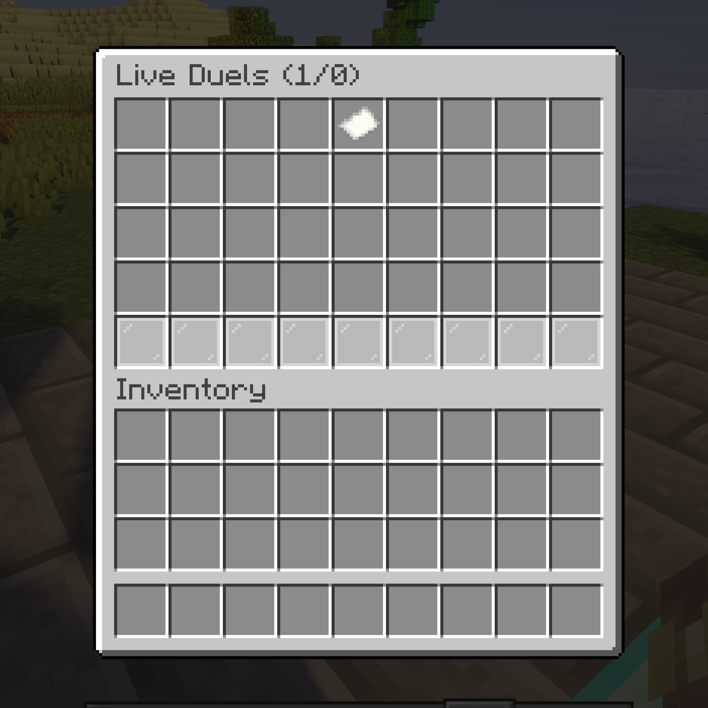

# Spectating

Watch live duels without interfering. Requires `duels.spectate` (granted to everyone by default).

## How to spectate

```text
/duel spectate              # open the live-match browser
/duel spectate <player>     # spectate that player's match directly
/duels spectate [player]    # same, under the admin command
```

Click a head in the browser to jump in. Run the command again (no args) to stop. Fighters see `X is now spectating the match!` and `X stopped spectating.` — unless you have `duels.spectate.anonymously`, which hides both messages.

<!-- IMAGE PLACEHOLDER
File: assets/images/spectate-gui.png
What to capture:
Live-match browser GUI with player heads, arena/kit/bet/duration lore visible.

Recommended size: 1200x700
-->


## What spectators experience

- Teleported above the target; adventure mode + flight (or vanilla spectator mode with `use-spectator-gamemode`), invisibility effect unless disabled, non-colliding.
- Most commands blocked (allowlist: `spectate.whitelisted-commands`); teleports and interaction cancelled; can't damage or be damaged; can't pick up items.
- Leaving the arena area teleports you back (**wall limit**, see below).
- When the match ends you're notified and returned to your pre-spectate state.

## Configuration (`spectate.*`)

| Option | Default | Effect |
|---|---|---|
| `enabled` | `true` | Master switch for all spectating |
| `wall-limit.enabled` / `.radius` | `true` / `25.0` | Leash around the arena center; cross it and you're pulled back with a message |
| `requires-cleared-inventory` | `false` | Empty inventory required |
| `use-spectator-gamemode` | `false` | True vanilla spectator mode instead of adventure+flight |
| `add-invisibility-effect` | `true` | Invisibility (ignored in spectator gamemode) |
| `whitelisted-commands` | msg-like list | Commands usable while spectating |
